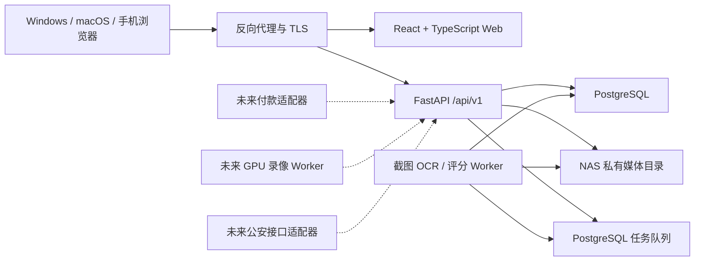

# 电竞教育学员 ERP 系统设计

日期：2026-07-26

状态：设计对话已确认，待用户复核书面版本

## 1. 项目定位

本系统服务单一电竞教育机构，用一套响应式 Web 管理账号、学员、工作人员、电竞项目、付款、营期与班级、教练评价、截图自动评价、住宿、访客和实名入住信息导出。

首版在本地开发，验收后通过 Docker Compose 部署到 NAS。同一套前端必须适配 Windows、macOS、平板和手机浏览器，不开发独立桌面或手机 App。

手机号是主要业务检索条件，但数据库使用内部 UUID 作为稳定主键。学员上传截图后，可以把不同电竞项目的游戏 ID 绑定到对应学员及手机号账号。

## 2. 目标与成功标准

首版成功标准：

1. 管理员能创建和维护人员、账号、角色及细分权限。
2. 付款记录能通过通用 API 或模拟导入进入系统，并按手机号匹配；管理员确认后分配电竞项目、营期和班级，系统从班级带出主/助教，再安排住宿。
3. 教练登录后能一键查看自己负责的下一期学员名单，并填写每日、每周评语。
4. 获得上传权限的教练、家长或学员能上传游戏截图；系统完成 OCR 和规则评分，教练审核发布后家长可见。
5. 家长或学员登录后能切换多个已绑定学员，查看付款、营期/班级、教练评语和已发布的历史评价。
6. 管理员能维护楼栋、楼层、单人房、双人房和房态，为正式人员安排常住、随营或临时入住，并为访客安排临时入住。
7. 系统能阻止房间超额和异性共住，显示室友，保留换房历史，并要求管理员二次确认退营后才释放床位。
8. 系统能校验实名资料，生成包含身份证等字段的入住人员导出，并完整记录敏感数据查看、导出和报送操作。
9. PostgreSQL 与私有截图文件能够完成备份、还原和一致性验证。

## 3. 首版范围与后续范围

### 3.1 首版包含

- 手机号和密码登录。
- 单机构账号、人员、角色和细分权限。
- 学员、监护人、教练、生活老师、客服、其他工作人员和临时访客档案。
- 电竞项目分类，可由管理员新增、编辑、排序或停用。
- 通用付款导入契约、模拟导入和待分配队列。
- 营期、教学班级、教练分配、开营日期和结束日期。
- 教练下一期名单、每日评语和每周评语。
- 游戏截图私有上传、OCR、规则评分、教练审核和历史评价。
- 楼栋、楼层、房间、床位、入住、换房、退营和访客管理。
- 实名入住名单 Excel/CSV 导出、报送状态和审计。
- 响应式桌面端和手机端界面。
- 本地开发环境和 NAS Docker Compose 部署。

### 3.2 明确延后

- 真实付款平台适配、用户自助选项目及跳转支付。
- 公安住宿系统在线 API 同步；首版只提供可审计的 Excel/CSV 导出和报送状态。
- 录像上传、GPU 录像分析和视频评价。
- 天赋测评首测分支。
- 多机构租户能力。

延后功能必须通过版本化接口接入，不改变首版的学员、报名、营期/班级、评价和住宿核心模型。

## 4. 使用者、账号与权限

### 4.1 人员与账号分离

`person` 表示现实中的一个人，`user_account` 表示其登录凭据。所有正式用户都同时拥有人员档案和登录账号；临时访客只建立人员及访客档案，默认不开通账号。

所有人员档案必须填写：

- 姓名
- 身份证号码
- 性别
- 出生日期

所有正式登录账号还必须填写：

- 手机号
- 邮箱
- 账号状态

未成年学员必须至少绑定一名有效实名监护人。有效监护人本人必须已满 18 周岁，记录姓名、手机号和身份证号码，并拥有处于启用状态且具备监护人角色的独立账号；一名监护人可以绑定多名学员，一名学员也可以绑定多名监护人。出生日期是独立结构化字段，并与身份证信息进行一致性校验。单项功能权限被收回只阻止对应功能，不改变监护人的实名有效性。

未成年学员尚未绑定有效监护人时允许先保存为草稿，人员名单显示红色“待绑定监护人”，但禁止开通或重新启用学员账号、确认报名以及向家庭端开放评价查看。绑定有效监护人后自动解除就绪限制。详细规则见 `2026-07-27-minor-guardian-readiness-design.md`。

最后一名有效监护人失效时，系统自动停用未成年学员账号并撤销全部会话；重新绑定后由管理员手动启用。学员满 18 周岁后不再强制要求监护人，但仍可继续或新建监护关系，监护人按有效关系和家庭权限继续查看该成年学员，直到管理员结束关系或到达预设结束日期。关系结束不物理删除；再次绑定同一双方时建立新的历史记录。

学员档案不强制拥有独立登录账号：未成年人可以只由监护人账号访问。无论是否开通账号，学员本人的姓名、身份证、性别和出生日期都必须完整。如果为学员开通独立账号，该账号还必须填写手机号和邮箱。登录手机号在有效账号中唯一；同一家庭共用一个手机号时，使用一个监护人账号绑定多名学员，不创建多个同手机号账号。

“未成年”按业务动作发生日计算：普通资料校验以当前日期为准，入住及报送以计划入住日期为准；未满 18 周岁即要求有效监护人关系。所有日期计算统一使用 `Asia/Shanghai` 时区。

### 4.2 基础角色

| 角色 | 默认能力 |
| --- | --- |
| 管理员 | 全量业务管理、人员账号、权限、付款、分配、住宿、敏感导出和审计 |
| 教练 | 查看本人负责的班级和学员，填写每日/每周评语，审核本人班级的自动评价 |
| 客服 | 查看学员名单和脱敏手机号 |
| 生活老师 | 登录系统并查看管理员授予的住宿或人员范围 |
| 其他工作人员 | 登录系统，仅拥有管理员明确授予的功能 |
| 家长/学员 | 查看自己绑定的学员、付款、营期/班级和已发布评价 |

### 4.3 细分权限

系统采用“基础角色权限 + 账号级追加或收回权限”。至少独立控制：

- 可查看的数据范围：全部、指定班级、本人负责班级、本人家庭。
- 查看完整手机号。
- 查看完整身份证。
- 查看付款详情。
- 上传截图。
- 审核或发布自动评价。
- 编辑学员或人员档案。
- 分配营期/班级和住宿。
- 导出名单。
- 导出完整实名信息。

教练、家长和学员没有默认截图上传权。管理员可以按账号开启或收回上传权限。每次授权必须记录授权人、授权时间和权限变化。

权限判定采用默认拒绝和匹配对象的“拒绝优先”规则：

1. 没有任何匹配允许规则时拒绝访问。
2. 多个角色的允许规则取并集，但只在各自授权的数据范围内生效。
3. 账号级显式拒绝优先于账号级允许和角色允许。
4. 账号级显式允许可以扩展角色能力，但必须由有权限的管理员下发并带明确数据范围。
5. 查看范围与操作能力分别判定；能查看学员名单不自动获得完整手机号、身份证、付款、导出或编辑能力。
6. 对同一对象同时命中允许和拒绝时，一律拒绝并记录策略来源，避免实现时采取不安全的推断。

### 4.4 登录安全

- 密码使用 Argon2id 哈希，系统不保存明文密码。
- 管理员创建的账号使用一次性临时密码，首次登录强制修改。
- 登录使用服务端会话和 `Secure`、`HttpOnly`、`SameSite` Cookie。
- 所有修改请求进行 CSRF 防护。
- 连续失败登录触发渐进式限速和短期锁定。
- 账号停用后立即失效现有会话。

## 5. 核心业务模块

### 5.1 学员与人员中心

- 以手机号为主要查询入口，同时支持 ERP 学员编号、姓名和游戏 ID 辅助查询。
- 家长账号可绑定多名学员，并在家长端切换。
- 学员可以绑定多个电竞项目的游戏 ID。
- 工作人员统一建立 `staff_profile`，人员类型包括教练、生活老师、客服、行政管理和其他工作人员；工作人员类型与登录角色分开，避免把“住校身份”和“系统权限”混为一谈。
- 教练、生活老师、客服、管理员和其他工作人员均作为正式账号录入。
- 临时访客记录姓名、手机号、身份证、性别、出生日期、来访原因和关联学员；默认无登录账号。
- 身份证在数据库中字段级加密，普通页面只显示脱敏值。

### 5.2 电竞项目、营期与班级

项目是可编辑数据，不写死在代码中。初始项目可包含：

- 英雄联盟
- 和平精英
- 三角洲行动
- 无畏契约

管理员可以新增、编辑、排序或停用项目。历史记录继续保留已经停用的项目名称和关联。

为避免“班期”和“班级”混用，系统采用两层结构：

- 营期 `cohort`：一次开营批次，记录开营日期、结束日期和住宿默认日期；一个营期可以包含多个电竞项目的教学班级。
- 班级 `class`：营期内的具体教学组，必须属于一个电竞项目，记录班级名称、人数上限和启用状态；班级默认继承营期日期。
- 教练分配 `coach_assignment`：班级必须有且只有一名主教练，可以有多名助教。主教练负责自动评价的默认审核，主教练和助教都能在权限范围内查看班级名单和填写评语。

营期状态为：

`draft -> open -> upcoming -> active -> completed -> archived`

状态含义：

- `draft`：内部草稿，不进入报名选择或教练下一期名单。
- `open`：开放分配，尚未开营。
- `upcoming`：已停止新增分配但尚未开营。
- `active`：已经开营。
- `completed`：已经结束，等待必要的收尾工作。
- `archived`：历史归档。

营期从 `draft` 进入 `open` 前，所有启用班级必须已分配一名主教练。

“下一期名单”只取教练作为主教练或助教参与、所属营期状态为 `open` 或 `upcoming`、且开营时间晚于当前时间的班级。默认一键打开最近开营日期；同一最近日期有多个班级时全部展示，并允许切换查看更晚的班级。`draft`、`active`、`completed` 和 `archived` 不进入下一期名单。

### 5.3 付款导入与待分配

首版定义通用付款导入接口，不绑定具体平台。最小输入：

- `source_system`
- `external_order_id`
- `idempotency_key`
- `payer_phone`
- `amount`
- `currency`
- `paid_at`
- `raw_payload`

处理规则：

1. `source_system + external_order_id` 和 `idempotency_key` 都必须具备唯一约束。
2. 手机号唯一匹配到现有账号时，付款先关联付款人账号及对应人员；如果付款人是监护人或绑定多名学员，仍由管理员确认本次付款对应的学员档案。
3. 手机号不存在或出现冲突时，只创建待处理付款，不会用不完整资料创建可登录账号。
4. 付款成功后生成“待分配单”；待分配单可以在学员尚未匹配时存在，但不能成为正式报名。
5. 管理员先确认或创建资料完整的学员档案，再选择项目、营期和班级。教练归属来自该班级的主教练/助教分配，不在单个报名上重复选择。
6. 确认完成后系统以学员 `person_id` 创建正式报名并关闭待分配单；学员无需拥有独立登录账号。此时才进入教练的下一期学员名单。

付款和报名状态分开保存，避免把“已付款”误当成“已分班”。

### 5.4 教练评价

教练可以在本人负责的学员和班级内填写：

- 每日评语
- 每周评语

每条评语必须指向一个具体报名 `enrollment`，因此同时确定学员、班级、营期和项目，不创建模糊的“全班评语”。

评语周期统一使用 `Asia/Shanghai`：

- 每日评语的周期键是一个自然日。
- 每周评语的周期键是周一至周日。
- 同一教练对同一报名、同一评语类型和同一周期只能有一条有效评语；主教练和助教可以分别提交自己的评语。
- 教练可以在营期日期范围内补录或回填，系统记录实际创建时间和所评周期，不伪造发布时间。
- 未填写的周期只显示为待办或逾期，不自动生成空评语。

教练提交后直接对已绑定家长/学员可见。修改不会覆盖历史版本；系统保存原内容、修改内容、作者、所评周期和时间。

### 5.5 截图自动评价

首版复用并重构 [game-score-tool](https://github.com/skymoonzyj/game-score-tool) 的截图 OCR 和规则评分能力。评测逻辑作为内部模块运行，不直接复用原项目的匿名页面、公开上传路径或 SQLite 数据库。

处理流程：

1. 检查上传人是否拥有截图上传权限及目标学员访问权。
2. 流式接收图片，校验真实 MIME、扩展名、大小、像素和哈希。
3. 文件保存到 NAS 私有媒体目录，数据库只记录不透明媒体编号。
4. 后台 Worker 执行 OCR 和规则评分，记录输入快照、OCR 版本、规则版本、字段置信度、分数拆解和警告。
5. 识别出的游戏 ID 经教练或管理员确认后绑定到学员和游戏项目。
6. 结果进入“待教练审核”，不会直接对家长发布。
7. 教练可以修改识别字段、补充建议、退回无效截图或确认发布。
8. 只有“已发布”版本对家长/学员可见；后续修订继续保留旧版本。

可编辑电竞项目与自动分析能力分开管理。每个项目有一个 `analysis_profile`：

- `automatic`：存在已启用且版本化的 OCR/评分适配器，可以自动处理。
- `manual_only`：允许获权用户上传截图，但只进入人工录入/审核，不调用未知规则。

新建项目默认为 `manual_only`。只有管理员配置并启用经过验收的适配器和规则版本后，才能切换为 `automatic`。

评价任务状态：


```text
uploaded -> queued -> processing -> needs_review -> published
                                  -> rejected
                     -> failed -> queued         # 重试
                               -> manual_review -> needs_review
```

`rejected` 用于无效、错误归属或不可识别的截图；拒绝原因对上传人可见。`manual_review` 允许有权限的教练或管理员手工录入结构化数据，再回到 `needs_review`。

审核默认路由给班级主教练。班级缺少主教练时任务进入管理员审核队列，不能自动发布；管理员可以自行审核或先补充分配主教练。已发布评价如需修订，会创建新的 `needs_review` 版本，旧发布版本继续可见，直到新版本审核发布后替换为当前版本。

首版不上传或分析录像；只保留未来视频任务 API 的扩展边界。

### 5.6 住宿与房态

住宿采用可编辑层级：

`楼栋 -> 楼层 -> 房间 -> 床位`

当前只录入一栋楼，未来可以新增第二、第三栋。房间记录房间号、房型、容量、状态和备注。首版房型包含单人房和双人房；房型及容量由管理员配置。停用或维修中的房间不可分配。

可入住人员：

- 学员
- 教练
- 生活老师
- 客服
- 行政管理员
- 其他工作人员
- 临时访客

住宿类型：

- 常住：允许开放式或管理员指定的结束日期。
- 随营：默认继承营期的开营和结束日期，管理员可单独调整。
- 临时入住：必须填写明确入住和退房日期及来访原因。

正式人员档案可以使用常住、随营或临时入住。临时访客档案只能使用临时入住，不能被设置为常住或随营。

入住记录区分计划和实际时间：

- `planned_checkin_at`、`planned_checkout_at` 用于预订和提醒。
- `actual_checkin_at`、`actual_checkout_at` 表示床位真正占用和释放的时间。
- 状态为 `reserved -> checked_in -> checkout_pending -> checked_out`，取消预订使用 `cancelled`。

分配规则：

1. 管理员从房态中选择人员、住宿类型、日期和床位。
2. 双人房显示现有室友。
3. 共住房间禁止不同性别同时入住；该规则是提交拦截，不只是警告。
4. 预订冲突按计划日期校验；`checked_in` 和 `checkout_pending` 始终视为实际占用，即使计划结束日期已经过去，也不会释放容量。
5. 未来预订可以安排在现有住宿的计划结束日期之后，但实际入住时必须再次校验；如果上一位仍处于 `checked_in` 或 `checkout_pending`，新入住被阻止。
6. 分配和入住提交在数据库事务中再次校验，防止多人同时操作造成超住。
7. 换房是一个原子管理员操作：在同一事务中以换房时间结束旧记录、立即释放旧床位并创建新房间的已入住记录；保存原房间、新房间、原因和操作人，不需要再执行退营确认。
8. 到达计划结束日期后，住宿进入 `checkout_pending`，不会自动写入实际退房时间或释放床位。
9. “退营二次确认”指管理员点击确认退营后，系统再次显示人员、房间和实际退房时间，管理员确认无误才写入 `actual_checkout_at`、转为 `checked_out` 并释放床位。

房态总览至少显示：

- 房间总数
- 已占用房间数
- 单人房和双人房数量
- 可用床位数
- 部分占用、已满、停用/维修房间
- 常住、随营、临时访客人数
- 待退营确认人数

### 5.7 实名入住导出与报送状态

首版不假设当地公安系统存在可用 API。系统生成 Excel/CSV 入住人员名单，并维护：

`pending -> exported -> reported`

失败或退回时使用：

`export_failed`、`rejected_for_correction`

生成名单前必须检查：

- 每位入住人员本人的姓名、身份证、性别和出生日期完整，无论其是否拥有独立登录账号。
- 拥有正式登录账号的人员还必须具备手机号和邮箱。
- 按计划入住日期计算仍未满 18 周岁的学员，至少绑定一名满足人员中心统一标准的有效成年监护人账号。
- 临时访客的姓名、手机号、身份证、性别、出生日期、来访原因和入住日期完整。
- 入住、换房和退房状态一致。

完整身份证导出需要独立权限、再次确认和操作用途。系统记录导出人、导出时间、筛选范围、文件哈希和报送结果。未来取得当地公安接口后，以适配器替换人工导出步骤，但保留相同状态和审计模型。

## 6. 未来自助报名与支付

真实支付平台确定后增加：

1. 用户注册并填写手机号、邮箱、身份证；未成年账号填写监护人资料。
2. 用户浏览电竞项目、报名时间、价格和住宿说明。
3. ERP 创建唯一待支付订单，保存项目、价格和报名信息快照。
4. 浏览器跳转到第三方支付页面。
5. 支付平台通过服务端签名回调或主动查单确认结果。
6. 付款成功后复用首版的待分配、分班、教练名单和住宿流程。

支付返回页面不能作为到账依据。重复回调必须幂等；取消或超时订单保持未支付或已关闭状态。支付平台通过适配器接入，不能把供应商字段渗透到核心报名模型。

## 7. 数据模型

以下为逻辑实体，实施计划可以按模块拆分迁移：

### 7.1 身份与权限

- `people`
- `user_accounts`
- `roles`
- `permissions`
- `user_roles`
- `user_permission_overrides`
- `guardian_relationships`
- `staff_profiles`
- `student_profiles`
- `visitor_profiles`

### 7.2 教学运营

- `game_projects`
- `project_analysis_profiles`
- `student_game_accounts`
- `cohorts`
- `classes`
- `coach_assignments`
- `admission_cases`
- `enrollments`
- `payment_import_events`
- `payments`
- `payment_conflicts`

### 7.3 评价

- `coach_reviews`
- `coach_review_revisions`
- `media_assets`
- `evaluation_jobs`
- `evaluation_inputs`
- `evaluation_results`
- `evaluation_revisions`

### 7.4 住宿与报送

- `buildings`
- `floors`
- `rooms`
- `room_beds`
- `stay_assignments`
- `stay_change_events`
- `report_batches`
- `report_batch_people`

### 7.5 公共追踪

- `audit_events`
- `outbox_events`

所有业务表使用内部 UUID、创建时间、更新时间和操作人。需要恢复的业务记录采用软删除；审计事件只追加，不允许普通业务账号修改或删除。

## 8. 技术架构

### 8.1 组件



推荐技术：

- 前端：React、TypeScript、Vite，采用响应式组件和移动端卡片布局。
- 后端：Python 3.12、FastAPI、SQLAlchemy、Alembic。
- 数据库：PostgreSQL。
- 异步截图处理：独立 Worker 使用 PostgreSQL 任务表领取任务，首版不额外引入 Redis。
- 媒体：NAS 私有卷，禁止把上传目录直接挂载为公开静态目录。
- OCR：Tesseract 及中文语言包，显式支持 Linux 容器的 PATH/环境变量配置。
- 部署：Docker Compose，包含反向代理、Web/API、截图 Worker 和 PostgreSQL。

### 8.2 API 边界

所有接口使用 `/api/v1`。主要资源：

- `/auth`
- `/people`
- `/students`
- `/staff`
- `/visitors`
- `/permissions`
- `/projects`
- `/cohorts`
- `/classes`
- `/coach-assignments`
- `/enrollments`
- `/payment-imports`
- `/coach-reviews`
- `/media`
- `/evaluation-jobs`
- `/housing/buildings`
- `/housing/rooms`
- `/housing/stays`
- `/identity-report-batches`

写入接口必须验证对象级权限。外部导入接口使用服务账号、签名、幂等键和原始事件留存。未来 Worker 与支付、公安适配器使用独立的最小权限机器凭证；凭证缺失时服务必须拒绝启动或拒绝请求，不能自动放行。

### 8.3 媒体和敏感信息

- 上传采用流式写入，限制文件数、大小、真实类型和像素。
- 媒体保存在 Web 根目录之外，通过鉴权接口或短期签名地址读取。
- 数据库只保存对象键、哈希、所有者、状态和保留策略。
- 身份证和完整手机号使用应用层信封加密；加密主密钥通过 Docker secret 提供。
- 手机号和身份证另存不可逆的带密钥检索摘要，用于精确匹配、唯一性检查和重复人员提示，列表不依赖解密后全表扫描。
- 列表和日志默认不输出完整身份证、完整手机号、OCR 原文或私有媒体地址。
- 敏感字段查看、修改、导出和解密都写入审计事件。

## 9. 响应式界面设计

### 9.1 桌面端

- 固定或可折叠侧栏。
- 数据概览、筛选、表格和批量操作。
- 管理员首页重点显示待分配、即将开营、待审核评价、房态和待退营。
- 房态采用楼栋/楼层筛选和房间卡片网格。

### 9.2 手机端

- 表格自动转为卡片。
- 底部主导航和适合单手操作的大按钮。
- 家长首页支持多学员切换、查看营期/班级、评价、付款和获权后的截图上传。
- 教练首页突出下一期名单、评语待办和截图审核。
- 客服和工作人员按权限只显示可用模块。

断点策略以内容适配为准，至少验收 360px 手机、768px 平板、1024px 小桌面和 1440px 宽桌面。

## 10. 异常处理

| 场景 | 系统行为 |
| --- | --- |
| 重复付款 | 返回已有处理结果，不重复创建付款或报名 |
| 手机号冲突 | 进入人工冲突队列，不自动覆盖或合并人员 |
| 实名信息不完整 | 允许保存草稿，禁止确认入住和生成报送名单 |
| 房间容量/性别/日期冲突 | 事务内再次校验并拒绝提交，返回明确原因 |
| 截图 OCR 失败 | 保留私有原图和失败原因，可重试或转手工录入 |
| 自动评分数据异常 | 进入待审核或失败状态，不发布给家长 |
| 导出失败 | 保持待导出或失败状态，允许重试，不标记已报送 |
| 误删或误改 | 关键业务软删除并保留版本，可由管理员恢复 |
| NAS 文件不可用 | 阻止任务继续并告警，不写入虚假的成功状态 |

## 11. 测试与验收

### 11.1 自动化测试

- 单元测试：权限拒绝优先、手机号规范化、付款幂等、未成年日期判定与监护人规则、营期状态、下一期名单、每日/每周周期键、房间容量、性别限制、计划/实际入住冲突和评价状态机。
- 数据库集成测试：事务并发分房、唯一约束、迁移、软删除和审计追加。
- API 契约测试：通用付款导入、分页、错误结构、对象级权限和未来适配器边界。
- 文件测试：伪造 MIME、超大图片、重复图片、私有访问、OCR 成功/失败/重试。
- 端到端测试：管理员、教练、客服、生活老师、家长/学员的关键旅程。
- 响应式测试：桌面、平板和手机尺寸的导航、表格转卡片、上传和房态操作。

### 11.2 必过验收场景

1. 付款导入匹配监护人后，管理员选择其多名学员中的正确学员并完成分班，再进入主/助教下一期名单。
2. 没有独立登录账号的未成年学员在绑定有效监护人账号后，可以由监护人完成报名、入住和评价查看；未绑定时保持待绑定并阻止这些家庭端业务，最后一名有效监护人失效时自动停用已有学员账号并撤销会话。
3. 家长绑定多名未成年或成年学员并切换查看；成年后关系继续有效，直到管理员结束关系。
4. 管理员按账号开启/关闭教练或家长的截图上传权，并验证显式拒绝优先。
5. 自动分析项目和仅人工项目分别走正确流程；截图识别失败、重试、手工录入、教练修正、拒绝、发布和历史版本均可追溯。
6. 客服能看名单但不能越权查看身份证、付款或导出。
7. 双人房显示室友，拒绝异性同住、超住和重叠入住。
8. 学员、教练、生活老师、客服、行政员工、其他员工和访客都能按允许的住宿类型入住，访客不能选择常住或随营。
9. 换房原子释放旧床位并保留历史；计划结束后未确认退营仍保持实际占用并阻止新入住。
10. 按计划入住日期仍未成年的学员，缺少有效成年监护人账号时不能生成入住报送名单。
11. 敏感名单导出经过独立权限、二次确认并产生审计记录。
12. PostgreSQL 与媒体文件完成一次真实备份、还原和一致性验证。

## 12. NAS Docker 部署与运维

- 本地和 NAS 使用同一套 Compose 服务定义，环境差异通过配置和 Docker secret 注入。
- PostgreSQL 数据使用 NAS 主机上受支持的本地 Docker 卷，不把数据库文件放在 SMB/NFS 共享目录。
- API 和数据库端口不直接暴露公网；统一通过反向代理访问。
- 容器使用非 root 用户、固定 UID/GID、健康检查、资源限制、重启策略和日志轮转。
- 数据库、身份证加密密钥、会话密钥和机器凭证分别管理。
- 备份同时覆盖 PostgreSQL 与私有媒体；NAS 快照之外保留独立副本。
- 定期执行恢复演练，校验数据库媒体哈希与缺失文件。

## 13. 实施阶段

本文件是总体设计，不把全部模块塞进一个超大实施计划。首版拆成四个可独立验收、顺序实施的子项目：平台基础、招生教学运营、教学评价、住宿与实名导出。书面设计获批后先为阶段 1A 编写实施计划；后续阶段开始前，分别从本总体设计派生聚焦的实施规格与计划。

### 阶段 1A：平台基础

- 项目脚手架、响应式 Web 外壳、Docker 本地开发环境和 PostgreSQL 迁移。
- 账号、人员、实名字段、监护人、角色和权限。
- 人员名单成年状态、未成年监护就绪提醒和账号开通阻断。
- 会话安全、敏感字段加密、审计基础、统一错误结构和自动化测试框架。

### 阶段 1B：招生与教学运营

- 电竞项目、营期、班级和主/助教分配。
- 付款导入、冲突处理、待分配单和正式报名。
- 教练下一期名单、家长多学员切换和对应响应式页面。
- 首次 NAS 预发布部署、数据库备份和恢复演练。

### 阶段 2：教学评价

- 每日/每周教练评语。
- 私有截图上传。
- 抽取和重构现有 OCR/评分模块。
- 后台任务、教练审核、发布与历史版本。
- 私有媒体备份和恢复演练。

### 阶段 3：住宿与实名导出

- 楼栋、楼层、房间和床位。
- 常住、随营、访客、换房、退营二次确认。
- 房态统计、身份完整性校验和实名 Excel/CSV 导出。
- 完整 NAS 生产候选部署和数据库/媒体联合恢复演练。

### 阶段 4：外部扩展

- 用户自助注册、项目选择和第三方支付跳转。
- 真实付款平台适配器。
- 当地公安住宿系统 API 适配器。
- GPU 录像分析服务。
- 天赋测评首测分支。

每个阶段都必须同时交付该模块的桌面/手机响应式界面、权限规则、审计事件、数据库迁移、错误处理和自动化测试，不允许把这些横切工作推迟到最后。每个阶段完成后必须通过对应业务验收；阶段 3 完成并通过联合备份恢复后，首版才具备生产上线条件。

## 14. 设计决策摘要

- 采用模块化单体，不直接在原评分工具上堆叠 ERP，也不在首版拆成大量微服务。
- ERP 是人员、付款、营期/班级、评价和住宿的业务主系统。
- OCR/规则评分在同一代码库中以独立模块和 Worker 运行，未来录像分析再拆 GPU 服务。
- PostgreSQL 从首版开始使用，不把 SQLite 作为生产过渡方案。
- 手机号用于主要业务识别，内部 UUID 用于数据关系。
- 自动评价必须经教练确认；教练评语提交后直接发布并保留修订历史。
- 上传、身份证查看、付款查看和敏感导出都是独立权限。
- 住宿面向所有人员类型，异性共住和超额入住由系统强制拦截。
- 公安信息首版采用可审计导出，取得正式接口后再接自动同步。
- 录像、真实支付、自助报名和天赋测评不进入首版核心范围。
