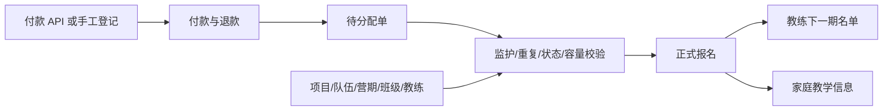

# 阶段 1B 招生与教学运营设计

**日期：** 2026-07-27
**状态：** 阶段 1B 第二模块待容器门禁复核
**所属阶段：** 阶段 1B；承接已完成的阶段 1A，教学评价仍在阶段 2，住宿仍在阶段 3

## 1. 目标

阶段 1B 把当前的人员、账号、监护就绪、权限和审计平台扩展为可实际执行招生分配的教学运营系统。完成后，系统必须能够：

1. 维护电竞项目、职业队伍、营期、普通班和菁英班，并为班级分配主教练和助教。
2. 通过通用签名 API 或管理员手工操作记录人民币付款和退款。
3. 把付款转为待分配单，由管理员确认学员、营期和班级后形成正式报名。
4. 在报名时执行监护就绪、重复报名、营期状态和班级容量校验。
5. 支持转班、取消报名、退营退费、重新待分配和有理由的超额报名，并保留完整历史。
6. 让教练一键查看自己的下一期学员名单，让监护人或学员查看获权范围内的营期、班级和本人付款。
7. 同时交付桌面和手机响应式页面、权限、审计、迁移、错误处理、自动化测试及首次 NAS 预发布准备。

## 2. 范围与交付顺序

阶段 1B 拆成三个连续、可独立验收的模块。

### 2.1 教学配置

- 电竞项目和职业队伍。
- 营期、普通班、菁英班和默认学费。
- 主教练、助教及分配历史。
- 营期手工状态流转和可选的自动开营、自动结营。

### 2.2 招生报名

- 通用付款导入、手工付款、部分退款和全额退款。
- 手机号匹配、冲突处理、待分配和分期付款归集。
- 正式报名、欠款、转班、取消、退营退费、重新待分配和超额审批。

### 2.3 教练与家庭端

- 教练下一期班级和学员名单。
- 监护人多学员切换及学员自己的教学信息页面。
- 付款人查看自己的付款和退款。
- 管理员运营概览和客服受限名单。

当前代码交付到 2.2“招生报名”为止，并已完成本地数据库、浏览器和四视口验收。2.3 的教练下一期学员名单、家庭教学查看和付款人自助页面仍未开放；每日/每周评价、截图上传与自动评价、游戏 ID、住宿房态、第三方支付平台适配器以及录像/GPU 分析也不属于本模块。Docker Compose、NAS 启动和恢复链通过前，不把本状态提升为“阶段 1B 第二模块已实现”。

三个模块按顺序实施。每个模块都必须在进入下一模块前通过对应 API、数据库、Web 和响应式测试。

## 3. 明确不在本阶段实现

- 每日和每周教练评语、截图上传、OCR、自动评价、游戏 ID 绑定及分析配置；这些进入阶段 2。
- 楼栋、房间、床位、房态、访客入住和实名导出；这些进入阶段 3。阶段 1B 只保存可供住宿继承的营期默认入住和退房时间。
- 自助注册、公开项目选择、支付跳转和真实付款平台适配器；这些进入阶段 4。
- 录像、GPU 分析和天赋测评。

不得为后续阶段提前创建行为尚未冻结的 `student_game_accounts`、`project_analysis_profiles`、评价或住宿表。

## 4. 模块边界

后端新增两个业务包：

- `app.teaching`：项目、职业队伍、营期、班级、教练分配和下一期名单。
- `app.admissions`：导入事件、机器凭证、付款、退款、待分配、正式报名和报名历史。

身份、监护就绪、账号、RBAC、审计、加密和事务工具继续由现有模块提供。招生模块只能调用 `GuardianReadinessPolicy` 判断监护就绪，不能再次实现年龄或监护人规则。

前端增加一个“招生教学”主导航区域。页面按资源职责拆分，不把项目配置、付款处理和班级名单堆叠在同一个巨型页面中。



## 5. 教学配置模型

所有业务实体使用 UUID、`created_at`、`updated_at` 和操作人字段。已经被历史记录引用的项目、队伍、营期和班级不得物理删除。

### 5.1 电竞项目 `game_projects`

- `id`
- `name`
- `sort_order`
- `is_active`
- `created_by_user_id`
- `updated_by_user_id`
- 时间戳

项目名称必须唯一。停用项目后不能创建新的职业队伍或班级，但历史班级、报名和名单继续显示原名称。

初始项目包含英雄联盟、和平精英、三角洲行动和无畏契约，由可重复执行的种子逻辑创建。

### 5.2 职业队伍 `professional_teams`

- `id`
- `project_id`
- `name`
- `notes`
- `is_active`
- 操作人和时间戳

每条职业队伍资料只属于一个电竞项目。同一俱乐部跨项目时分别建档。项目内队伍名称唯一；停用后保留历史关联。

### 5.3 营期 `cohorts`

- `id`
- `name`
- `starts_at`
- `ends_at`
- `default_check_in_at`
- `default_check_out_at`
- `status`
- `auto_start_enabled`
- `auto_complete_enabled`
- 操作人和时间戳

所有时间按 `Asia/Shanghai` 解释并以带时区时间存储。默认开营时间为开营日 `00:00`，默认结营时间为结束日次日 `00:00`；管理员可以为每个营期填写具体时间。`ends_at` 必须晚于 `starts_at`，默认退房时间不得早于默认入住时间。

营期状态为：

```text
draft -> open <-> upcoming -> active -> completed -> archived
```

- `draft`：仅内部配置。
- `open`：接受待分配确认和正式报名。
- `upcoming`：停止新增报名但尚未开营，可由管理员重新切回 `open`。
- `active`：已经开营，不再新增报名。
- `completed`：已经结营，报名转为完成状态。
- `archived`：只读历史。

除 `open <-> upcoming` 外不允许状态回退。`draft -> open` 前，所有启用班级必须有一名当前有效且账号可用的主教练。手工和自动状态变化都写入 `cohort_status_events`，包括旧状态、新状态、触发方式、操作者或调度任务及发生时间。

自动开营只执行 `open|upcoming -> active`，自动结营只执行 `active -> completed`。状态不兼容时不跳级，系统产生管理员提醒。独立调度进程轮询到期营期，并使用 PostgreSQL advisory lock 保证多实例下只处理一次；相关读写接口也执行轻量到期检查，避免调度进程短暂离线后长期显示旧状态。

### 5.4 班级 `teaching_classes`

- `id`
- `cohort_id`
- `project_id`
- `name`
- `class_type`：`standard|elite`
- `professional_team_id`：普通班为空，菁英班必填
- `capacity`
- `default_tuition_cents`
- `is_active`
- 操作人和时间戳

班级名称在同一营期内唯一。人数上限必须大于零，默认学费不得为负。菁英班必须关联启用且与班级项目一致的职业队伍；普通班不能关联职业队伍。

停用班级不接受新报名。存在有效报名时不能停用，管理员必须先转班或取消相关报名。历史记录继续显示停用班级。

### 5.5 教练分配 `coach_assignments`

- `id`
- `class_id`
- `coach_person_id`
- `assignment_type`：`primary|assistant`
- `valid_from`
- `valid_until`
- `ended_at`
- `ended_by_user_id`
- `end_reason`
- 操作人和时间戳

一个班级同时必须最多只有一名当前主教练，可以有多名当前助教；同一教练不能同时以两种身份重复分配到同一班级。新分配要求人员类型为教练，并拥有启用账号和教练角色。结束分配只写结束信息，不删除历史。

主教练或助教的班级访问范围根据当前有效分配实时计算。教练账号被停用或教练角色被移除后立即失去访问权，但原分配历史保留，班级进入“教练待修复”提醒。

## 6. 付款与待分配模型

### 6.1 机器账号与签名凭证

外部导入使用独立的 `service_accounts` 和可轮换的 `service_account_credentials`，不复用人员账号。凭证只在创建时显示一次；服务端保存凭证标识和使用平台密钥加密的 HMAC 密钥。停用账号或凭证后所有请求立即拒绝。

导入请求包含：

- `X-Service-Account`
- `X-Timestamp`
- `X-Nonce`
- `X-Signature`

签名使用 HMAC-SHA256，规范串包含 HTTP 方法、路径、时间戳、随机数和请求体 SHA-256。服务器接受时间偏差不超过五分钟的请求；服务账号和随机数组合至少二十四小时内唯一。签名失败、过期或重放请求不得创建业务记录。

### 6.2 导入事件 `payment_import_events`

- `id`
- `service_account_id`
- `source_system`
- `external_order_id`
- `idempotency_key`
- `payer_phone_digest`
- `payload_digest`
- `raw_payload_ciphertext`
- `received_at`
- `processing_status`
- `payment_id`
- `conflict_id`

`source_system + external_order_id` 与 `idempotency_key` 分别唯一。原始负载加密保存，日志和列表不输出完整手机号或原文。

相同唯一键和相同负载重复提交时返回第一次的处理结果，不重复创建付款。唯一键相同但负载摘要不同时创建 `payment_conflicts` 并返回冲突错误，不覆盖原记录。

付款导入请求体固定为：

- `source_system`
- `external_order_id`
- `idempotency_key`
- `payer_phone`
- `amount`：两位小数的字符串
- `currency`：阶段 1B 只接受 `CNY`
- `paid_at`
- `raw_payload`

首次成功创建返回 `201`，完全相同的幂等重放返回 `200` 和原业务标识，内容冲突返回 `409 payment_import_conflict`。响应不得回显完整手机号或原始负载。

### 6.3 导入冲突 `payment_conflicts`

- `id`
- `original_import_event_id`
- `conflict_type`：`external_order_payload_mismatch|idempotency_payload_mismatch|ambiguous_payer`
- `attempted_payload_digest`
- `attempted_raw_payload_ciphertext`
- `status`：`open|resolved|dismissed`
- `resolution_note`
- `resolved_by_user_id`
- `resolved_at`
- 时间戳

唯一键冲突的第二次请求不创建第二笔付款，但必须把尝试负载加密保存到冲突记录。手机号无法唯一决定付款人时可以先创建付款，同时建立 `ambiguous_payer` 冲突并让待分配单保持 `pending_match`。管理员解决或忽略冲突必须填写说明；解决冲突只能补充正确关联，不能改写原付款金额或原始事件。

### 6.4 付款 `payments`

- `id`
- `source_kind`：`api|manual`
- `source_system`
- `external_order_id`
- `payer_account_id`
- `payer_person_id`
- `amount_cents`
- `paid_at`
- `manual_note`
- `created_by_user_id`
- 时间戳

阶段 1B 只接受人民币，API 使用两位小数的十进制字符串，服务端转换为整数分；手工页面也以元输入、按分保存。金额必须大于零。API 只导入已经确认成功的付款，不把支付平台的临时状态渗透到核心付款表。

管理员可以手工登记付款，必须选择学员或待分配单，并填写金额、付款时间和备注。手工记录与 API 付款使用同一后续流程和审计规则。

### 6.5 退款 `payment_refunds`

- `id`
- `payment_id`
- `withdrawal_id`：普通手工退款为空
- `amount_cents`
- `refunded_at`
- `refund_type`：`manual|withdrawal_prorated|withdrawal_full`
- `reason`
- `created_by_user_id`
- 时间戳

退款只由获权管理员手工登记，支持部分或全额退款。单笔付款累计退款不得超过原付款金额，并通过行锁防止并发超退。退款不自动取消报名。

付款状态由原金额和累计退款推导为 `paid|partially_refunded|refunded`，不提供可被手工随意改写的状态字段。

退营退款可能跨多笔分期付款。系统按 `paid_at DESC, id DESC` 从最近付款开始自动拆分，为每笔原付款创建不超过其剩余可退金额的退款记录，并在确认前展示拆分明细。

### 6.6 待分配单 `admission_cases`

- `id`
- `student_person_id`
- `status`：`pending_match|ready|enrolled|closed`
- `agreed_tuition_cents`：选择目标班级前允许为空
- `tuition_override_reason`
- `current_enrollment_id`
- `closed_reason`
- 操作人和时间戳

`admission_case_payments` 把一张待分配单关联到一笔或多笔付款，支持分期付款；每笔付款最多关联一张待分配单，防止同一金额被重复使用。付款首次导入时：

1. 手机号唯一匹配到付款账号时先记录付款人；付款人本人是学员时可以直接选中该学员。
2. 付款人是监护人时，无论当前关联一名还是多名学员，都保持 `pending_match`，由管理员确认本次对应的学员。
3. 手机号没有账号匹配时保持 `pending_match`，不创建不完整人员或账号。
4. 唯一键或手机号存在不可自动决定的冲突时进入冲突队列。
5. 后续付款由管理员或明确的匹配规则附加到现有待分配单或报名，不重复创建正式报名。

`pending_match` 表示尚未确认学员；选择有效学员且净付款大于零后进入 `ready`；正式报名后进入 `enrolled`；确认无须继续处理的重复或无效单可以由管理员填写原因后转为 `closed`。已关闭待分配单不能直接恢复，重新使用对应付款前必须通过有审计记录的重新开放操作。

选择班级时，系统复制班级默认学费作为约定学费。管理员可以在确认报名前调整，但必须填写原因；确认后约定学费快照不可直接修改。净付款为关联付款总额减退款总额；欠款为 `max(约定学费 - 净付款, 0)`，多付金额单独显示。

## 7. 正式报名模型与状态

### 7.1 报名 `enrollments`

- `id`
- `admission_case_id`
- `student_person_id`
- `cohort_id`
- `class_id`
- `agreed_tuition_cents`
- `status`：`active|cancelled|completed`
- `capacity_override_reason`
- `confirmed_at`
- `cancelled_at`
- `completed_at`
- 操作人和时间戳

报名同时保存 `cohort_id`，并通过班级和营期的组合外键保证班级确实属于该营期。数据库部分唯一索引保证同一学员在同一营期最多只有一条 `active` 报名。

确认报名只允许从 `ready` 待分配单发起，并在同一 PostgreSQL 事务中：

1. 锁定待分配单、学员、目标班级和营期。
2. 确认净付款大于零。
3. 确认营期状态为 `open`，班级已启用。
4. 使用营期开营时间调用统一监护就绪策略；未成年且无有效监护人时返回 `minor_guardian_required`。
5. 确认同营期没有其他有效报名。
6. 统计目标班级有效报名人数并校验容量。
7. 满班时只允许拥有 `enrollments.capacity_override` 权限的管理员填写原因后继续。
8. 创建报名、把待分配单转为 `enrolled`，并写入报名事件和安全审计。

付款不要求全额付清；净付款大于零即可确认，欠款持续显示。

### 7.2 报名事件 `enrollment_events`

事件类型包括：

- `confirmed`
- `transferred`
- `cancelled`
- `withdrawal_refunded`
- `completed`
- `reopened_for_allocation`
- `capacity_overridden`

事件保存原班级、新班级、原状态、新状态、原因、人数快照、操作者和发生时间，不允许普通业务更新或删除。

### 7.3 转班

转班是原子管理员操作。系统锁定报名、原班级和目标班级，验证营期相同、目标班级启用、项目/菁英队伍关系有效及目标容量。需要超额时使用与确认报名相同的独立权限和原因。成功后更新当前班级并写入事件；原班级历史不丢失。

同一营期内更换项目也通过转班完成，因为班级决定项目。阶段 1B 不支持把同一报名跨营期移动；跨营期必须取消后通过待分配流程创建新营期报名。

### 7.4 取消与重新待分配

取消报名必须填写原因。事务内把报名转为 `cancelled`、释放班级名额、把待分配单转回 `ready` 并清空当前报名引用。原付款和退款继续关联该待分配单，可再次选择学员或班级。重新选择班级时按新班级重新生成约定学费，原报名中的学费快照不变。取消不自动退款。

管理员取消报名时可以选择：

- `no_refund`：只取消报名，不生成退款。
- `prorated_remaining_days`：按营期剩余自然日比例退款。
- `full_remaining_paid`：退还当前全部尚可退实付金额。

后两种属于“退营退费”，必须先展示计算预览，再由管理员二次确认。普通的独立手工退款仍不自动取消报名。

### 7.5 退营退款 `enrollment_withdrawals`

- `id`
- `enrollment_id`
- `admission_case_id`
- `withdrawal_date`
- `refund_policy`：`prorated_remaining_days|full_remaining_paid`
- `total_days_snapshot`
- `remaining_days_snapshot`
- `agreed_tuition_cents_snapshot`
- `available_paid_cents_snapshot`
- `calculated_refund_cents`
- `reason`
- `confirmed_by_user_id`
- `confirmed_at`
- 时间戳

自然日均按 `Asia/Shanghai` 计算。总天数包含开营日和结束日：

```text
total_days = 结束日期 - 开营日期 + 1
```

退营当天视为已经参加，剩余天数从次日开始：

```text
remaining_days = clamp(结束日期 - 退营日期, 0, total_days)
```

按期退款的理论金额为：

```text
round_half_up(最终约定学费 * remaining_days / total_days)
```

实际退款不得超过尚未退还的实付金额：

```text
available_paid = max(关联付款总额 - 已退款总额, 0)
prorated_refund = min(理论金额, available_paid)
full_refund = available_paid
```

金额使用整数分计算，除法结果采用四舍五入到分。开营前退营时 `remaining_days = total_days`；结束日或结束后按期退款为零。选择全部退款时不受剩余日期影响，但仍不能超过 `available_paid`。

预览接口返回退款政策、日期、计算快照、总退款和按原付款拆分的明细。确认接口锁定报名、待分配单、班级和全部关联付款后重新计算；如果金额或拆分与预览不一致，返回 `withdrawal_refund_changed`，要求管理员重新预览，不能静默使用新金额。

确认成功时在同一事务内创建 `enrollment_withdrawals`、各笔 `payment_refunds`、取消报名、释放名额、重新开放待分配单并写入报名事件和安全审计。没有尚可退金额时不能使用退费操作，管理员仍可选择 `no_refund` 取消。

阶段 3 接入住宿后，`withdrawal_refunded` 只触发待退营提醒，不直接释放正在占用的床位；住宿仍需完成独立的二次退房确认。

营期转为 `completed` 时，该营期剩余 `active` 报名转为 `completed` 并写入事件。归档后所有教学和招生数据只读。

## 8. 权限设计

新增权限按职责拆分，敏感付款权限不得由名单权限隐含获得：

- `teaching.read`
- `projects.manage`
- `professional_teams.manage`
- `cohorts.manage`
- `classes.manage`
- `coach_assignments.manage`
- `coach_roster.read`
- `admission_cases.read`
- `admission_cases.manage`
- `payments.read`
- `payments.manage`
- `refunds.manage`
- `enrollments.read`
- `enrollments.manage`
- `enrollments.capacity_override`
- `payment_imports.manage`

默认角色授权：

| 角色 | 默认能力 |
| --- | --- |
| 管理员 | 全部阶段 1B 权限，`global` 范围 |
| 教练 | `teaching.read`、`coach_roster.read`、`enrollments.read`，`assigned_class` 范围 |
| 客服 | `teaching.read`、`enrollments.read`、`admission_cases.read`，`global` 范围；只返回付款状态标签，不返回金额 |
| 监护人 | `teaching.read`、`enrollments.read`，`family` 范围；付款只通过本人付款专用接口读取 |
| 学员 | `teaching.read`、`enrollments.read`，`self` 范围；付款只通过本人付款专用接口读取 |
| 生活老师、其他员工 | 不增加默认阶段 1B 权限 |

现有显式拒绝继续优先于账号授权和角色授权。`assigned_class` 范围在本阶段接入当前有效教练分配，班级结束或分配失效后立即停止授予当前名单访问。

完整手机号、身份证和付款金额仍是相互独立的权限。教练默认只看姓名、学员编号、成年状态、项目、营期、班级及报名状态；客服默认只看付款状态 `未付|部分支付|已付|多付|已退款`，不能看到金额、身份证或完整手机号。

监护人只能查看自己作为 `payer_account_id` 的付款，即使另一名有效监护人也绑定同一学员，也不能查看该付款金额。管理员可查看学员关联的全部付款。没有付款账号的手工付款只在后台可见。

## 9. API 边界

接口统一位于 `/api/v1`：

- `/projects`
- `/professional-teams`
- `/cohorts`
- `/cohorts/{id}/transitions`
- `/classes`
- `/classes/{id}/coach-assignments`
- `/payment-imports`
- `/payments`
- `/payments/{id}/refunds`
- `/admission-cases`
- `/admission-cases/{id}/match-student`
- `/admission-cases/{id}/confirm-enrollment`
- `/enrollments`
- `/enrollments/{id}/transfer`
- `/enrollments/{id}/cancel`
- `/enrollments/{id}/withdrawal-refund-preview`
- `/enrollments/{id}/withdrawal-refund-confirm`
- `/coach/next-cohorts`
- `/family/students`
- `/family/students/{id}/teaching`
- `/me/payments`

列表统一分页、稳定排序并提供项目、营期、班级、状态、姓名、学员编号和手机号精确匹配筛选。手机号筛选使用现有带密钥摘要，不做解密全表扫描。

写接口使用现有 CSRF、请求 ID、统一错误结构、对象级权限和审计约定。机器付款接口不使用浏览器 Cookie 或 CSRF，而使用机器签名和独立限流。

## 10. 页面设计

### 10.1 管理员与客服

“招生教学”区域包含：

1. 运营概览：待分配数量、欠款人数、即将开营、教练待修复和班级容量。
2. 项目与职业队伍：紧凑列表、排序、启用/停用和关联项目筛选。
3. 营期列表与详情：基础信息、状态操作以及“班级 / 教练 / 学员”页签。
4. 付款与退款：来源、付款人、金额、退款、关联学员和冲突状态。
5. 待分配：匹配学员、选择班级、确认学费和处理冲突。
6. 正式报名：转班、取消、退营退费、欠款和付款汇总。

管理员名单显示约定学费、已付、已退、净付款、欠款或多付。客服使用同一业务列表结构，但服务端返回受限字段，页面只显示付款状态标签。

手工付款表单要求选择学员或待分配单、金额、付款时间和备注。退款必须从具体付款进入，并显示剩余可退金额。

退营操作先选择“不退款 / 按剩余日期退款 / 全部退款”。选择退款时先进入只读预览，显示退营日期、总天数、剩余天数、约定学费、尚可退实付金额、计算结果及按原付款拆分明细；管理员再次确认后才执行。

### 10.2 教练

教练首页突出“下一期学员”。只选择教练作为主教练或助教参与、营期状态为 `open|upcoming` 且开营时间晚于当前时间的班级。默认打开最近开营时间；同一时间有多个班级时一起显示，并可切换更晚营期。

名单不显示付款金额、身份证或完整手机号。没有下一期时显示空状态，不回退展示草稿、当前或历史班级。

### 10.3 家庭与学员端

监护人首先通过学员切换器选择有效关系内的学员，再查看当前和历史营期、项目、班级、班型、职业队伍和报名状态。成年后仍有效的监护关系继续可见，直到管理员结束关系。

未成年待绑定状态沿用阶段 1A 提示。付款已经可以导入，但正式报名被阻止时，家庭端不泄露内部诊断，只提示联系管理员补充有效监护信息。

付款页面只显示当前登录账号本人支付的付款和退款。学员账号同样只能看到本人作为付款人的记录。

### 10.4 响应式规则

- 1440px 和 1024px：侧栏、紧凑表格、固定筛选区和详情页页签。
- 768px：可折叠导航，表格保留关键列，次要字段进入详情抽屉或页面。
- 360px：底部主导航、列表转卡片、筛选菜单和全屏表单。
- 固定尺寸的状态标记、操作按钮和金额列不得因动态内容改变布局。
- 项目、营期、待分配和名单均不得依赖横向滚动才能完成核心操作。

## 11. 并发、错误和审计

### 11.1 并发保证

- 确认报名锁定待分配单、学员、营期和班级。
- 转班按稳定顺序锁定原班级和目标班级，避免死锁。
- 退款锁定原付款并重新计算累计可退金额。
- 退营退款按稳定顺序锁定报名、待分配单、班级和关联付款，确认时重新计算预览快照。
- 付款幂等依赖数据库唯一约束，而不是仅在应用层先查后写。
- 自动状态任务使用 advisory lock，并以状态条件更新保证重复执行无副作用。

### 11.2 稳定错误码

- `payment_signature_invalid`
- `payment_request_expired`
- `payment_replay_rejected`
- `payment_import_conflict`
- `refund_exceeds_paid_amount`
- `withdrawal_refund_changed`
- `withdrawal_nothing_to_refund`
- `admission_payment_required`
- `minor_guardian_required`
- `duplicate_cohort_enrollment`
- `class_capacity_reached`
- `capacity_override_reason_required`
- `invalid_cohort_transition`
- `primary_coach_required`
- `elite_team_required`
- `project_team_mismatch`

错误响应继续包含稳定 `code`、中文 `message`、字段级 `details` 和请求 ID。权限错误不得通过不同提示泄露付款、人员或班级是否存在。

### 11.3 审计

以下操作必须写入安全审计：项目和队伍变更、营期状态变化、班级和学费变更、教练分配、机器凭证管理、付款导入冲突处理、手工付款、退款、学员匹配、确认报名、超额报名、转班、取消、退营退款预览与确认以及付款金额查看。

领域事件表保存业务历史，安全审计保存“谁在何时通过什么请求执行了什么动作”。两者用途不同，不互相替代。

## 12. 测试与验收

### 12.1 自动化测试

- 单元测试：营期状态机、自动时间、班型/队伍一致性、人民币金额、付款汇总、退款上限、按期退费公式、退款拆分、欠款、下一期筛选和权限拒绝优先。
- PostgreSQL 集成测试：单一主教练、同营期单一有效报名、并发容量、超额权限、并发退款、退营预览失效、退营原子取消、付款双幂等、转班锁顺序和自动状态幂等。
- API 契约测试：机器签名、过期、重放、重复相同请求、重复冲突、分页、字段脱敏和错误结构。
- Web 测试：管理员、客服、教练、监护人和学员的权限页面与字段差异。
- E2E：管理员导入或手工登记付款、选择多学员监护人的正确学员、确认报名、教练看到下一期名单、客服看不到金额、付款人看到自己的付款。
- 响应式验收：360、768、1024 和 1440 四种宽度，至少覆盖导航、营期详情、待分配、报名名单和教练名单。

### 12.2 必过业务场景

1. 管理员创建项目、职业队伍、营期、普通班和菁英班；错误项目的职业队伍不能用于菁英班。
2. 没有主教练的启用班级阻止营期开放。
3. 自动开营和结营只执行合法相邻状态并且只记录一次事件。
4. API 重放同一付款返回原结果，内容冲突不覆盖原付款。
5. 监护人关联多名学员时，管理员选择正确学员后完成报名。
6. 未成年待绑定学员付款可保存但报名被阻止。
7. 部分付款可以报名并显示欠款；退款不自动取消报名。
8. 满班默认阻止，只有独立获权管理员填写原因后可以超额。
9. 转班原子释放原班名额并保留历史；取消后付款重新进入待分配。
10. 按期退费使用自然日和最终约定学费计算，从退营次日起算且不超过尚可退实付金额；全部退款退还全部尚可退金额。
11. 多笔分期付款按最近付款优先拆分退款；预览变化时阻止确认，成功时退款、取消和释放名额原子完成。
12. 教练只看到当前分配范围内的下一期名单。
13. 客服只看到付款状态，不看到金额；监护人只看到本人付款。
14. 桌面和手机都能完成核心流程且没有遮挡、溢出或不可达操作。

## 13. 迁移、备份和 NAS 预发布

阶段 1B 使用顺序 Alembic 迁移，不修改已经发布的 `0001` 至 `0003`。迁移测试必须同时覆盖空数据库升级和从 `0003_guardian_relationship_history` 升级到新 head。

现有恢复脚本中硬编码的 `0002_seed_rbac` 和固定表数量已经过时，阶段 1B 首个迁移任务必须改为校验当前迁移 head 和显式关键表清单，避免每次新增合法表后恢复演练误报。

阶段结束前必须：

1. 通过后端、前端、静态检查、迁移和响应式 E2E。
2. 在独立测试数据库执行真实备份、校验和恢复。
3. 验证 Compose 开发、E2E 和生产覆盖配置。
4. 准备 NAS Docker 预发布配置、密钥清单和回滚说明。
5. 只有 Docker daemon 和目标 NAS 上的实际启动、迁移、健康检查及恢复演练通过后，才标记阶段 1B 可预发布；本地测试通过不能替代 NAS 验证。

## 14. 设计决策摘要

- 阶段 1B 按教学配置、招生报名、教练与家庭端三个模块顺序交付。
- 项目和职业队伍是可编辑数据；职业队伍按电竞项目分别建档。
- 普通班不关联职业队伍，菁英班必须关联同项目职业队伍。
- 营期以管理员确认为主，可分别启用自动开营和自动结营并设置具体时间。
- 只有 `open` 和 `upcoming` 可以相互切换；开营后状态只向前。
- 同一学员同一营期最多一条有效报名，转项目或班级统一走转班。
- 满班默认阻止；独立获权管理员填写原因后可以超额。
- 班级提供默认学费，报名保存最终约定金额快照；调整必须填写原因。
- 只支持人民币并按分保存；部分付款可以报名，退款不自动取消报名。
- 取消报名释放名额并让原付款重新进入待分配。
- 退营可选择按剩余自然日比例退款或退还全部尚可退实付金额；预览后二次确认，并按最近付款优先拆分。
- 管理员可以查看学员付款汇总；客服只看状态；监护人和学员只看本人付款。
- 外部付款使用机器账号、HMAC 签名、时间窗、防重放、双幂等和加密原始事件。
- 住宿、评价、截图和游戏 ID 不提前进入阶段 1B。
